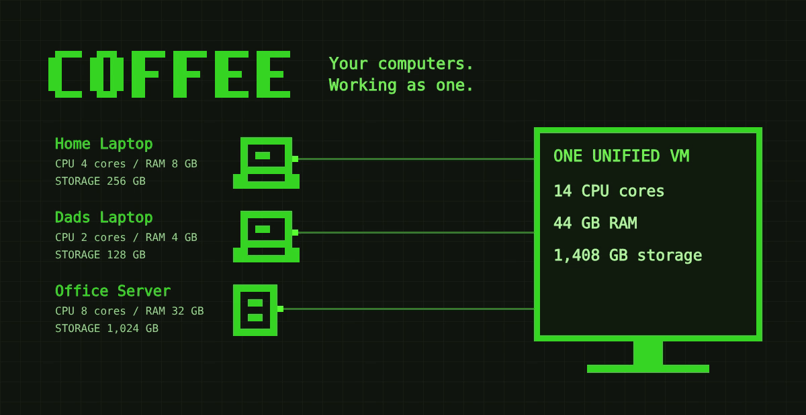
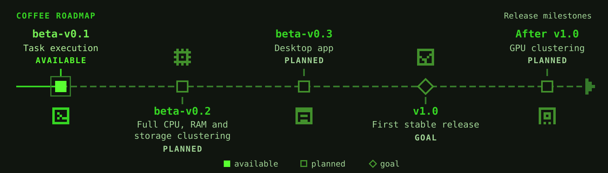

# What if your computers could become one?

Running an app across separate computers usually means managing every machine yourself: choosing where each part runs and moving files between them.
**Coffee is being built so a cluster of connected computers can work as one unified VM**, even across different locations.
You write one Recipe instead of separately managing every machine, and the goal is for Coffee to combine their CPU, memory and storage underneath.

## Example

Imagine using the resources of your home laptop, your dad's laptop and an office server through one machine.



## Terminology

| Name | Meaning |
| --- | --- |
| Bean | One contributing machine: a laptop, server or VM. |
| Cluster | Beans connected together. |
| Recipe | A `coffee.yaml` file that defines the Steps and the resources they need. |
| Step | One task in a Recipe: a command with its inputs, outputs, resources and dependencies. |
| Brew | One run of a Recipe. |
| Manager | Assigns Steps to Beans and tracks their progress. |

The current commands and file format keep their earlier names: a `JOB` argument is a Brew ID, a `TASK` argument is a Step ID, `coffee serve` starts the Manager and `coffee.yaml` still uses `tasks:`.

## Commands

Client commands use `COFFEE_SERVER` and `COFFEE_TOKEN_FILE`, as shown in the demo below.
Replace `JOB` (a Brew ID), `TASK` (a Step ID), `BEAN` and paths with your own values.

| Command | What it does |
| --- | --- |
| `coffee init --state ./.coffee` | Create or check the Manager's state directory. |
| `coffee validate coffee.yaml` | Check a Recipe before running it. |
| `coffee plan coffee.yaml` | Show Step order and dependencies. Add `--server URL` to check Bean capacity. |
| `coffee serve --state ./.coffee` | Start the Manager. |
| `coffee join --work-dir ./.coffee-bean` | Connect this machine as a Bean. |
| `coffee beans` | List Beans and their available resources. |
| `coffee drain BEAN` | Stop sending new Steps to a Bean. Use `--undo` to resume. |
| `coffee brew coffee.yaml --wait --out ./results` | Start a Brew, wait for it and download results. |
| `coffee status` / `coffee status JOB` | List Brews or inspect one Brew. |
| `coffee logs JOB TASK` | Read a Step attempt's output. Use `--stderr` for errors. |
| `coffee explain JOB TASK` | Explain why a Step is waiting or cannot fit. |
| `coffee cancel JOB` | Cancel a Brew. Add `--task TASK` to cancel a Step and its dependent Steps. |
| `coffee --help` / `coffee COMMAND --help` | Show command options. |
| `coffee --version` | Show the installed version. |

<details>
<summary>Build Coffee and run a two-Bean demo</summary>

Needs Ubuntu/Linux x86-64, a C++20 compiler, Python 3 with `venv`, `curl`, `tar` and `sha256sum`.
The bootstrap downloads pinned tools into this project; nothing is installed globally.
[Build details](docs/native-build.md).

```sh
scripts/bootstrap.sh
export PATH="$PWD/.tools/venv/bin:$PATH"
cmake -S . -B build -G Ninja && cmake --build build
ctest --test-dir build --output-on-failure      # optional, about 2 minutes
```

Run a Manager and two Beans on this machine, then a two-Step Recipe. Both Beans are worker processes on one computer, so this is a simulated two-Bean cluster:

<!-- quickstart:start -->
```sh
export PATH="$PWD/build:$PATH"
coffee init --state ./.coffee
coffee serve --state ./.coffee --listen 127.0.0.1:7077 --ready-file ./.coffee/ready.json > ./.coffee/serve.log 2>&1 &
until [ -s ./.coffee/ready.json ]; do sleep 0.1; done
export COFFEE_SERVER=http://127.0.0.1:7077 COFFEE_TOKEN_FILE="$PWD/.coffee/token"
coffee join --work-dir ./.coffee-bean-a --id bean-a --cpus 2 --memory-mb 2048 > ./.coffee/bean-a.log 2>&1 &
coffee join --work-dir ./.coffee-bean-b --id bean-b --cpus 2 --memory-mb 2048 > ./.coffee/bean-b.log 2>&1 &
until [ "$(coffee beans | grep -c online)" -ge 2 ]; do sleep 0.2; done
coffee beans
coffee brew examples/pipeline/coffee.yaml --job-id demo --wait --out ./results
cat ./results/stats/size.txt
coffee status demo
kill %1 %2 %3
```
<!-- quickstart:end -->

See [the demo output, task limits and installation steps](docs/getting-started.md).
For remote machines, use an SSH tunnel or an encrypted network; Coffee has no built-in TLS yet.
[Operations guide](docs/operations.md) · [CLI and protocol](docs/native-protocol.md).

</details>

## Roadmap



Planned milestones may evolve.

<details>
<summary>Roadmap details</summary>

- **beta-v0.1, Task execution: available.** Step execution, file pipelines, status, logs, retries and saved Manager state.
- **beta-v0.2, Full CPU, RAM and storage clustering: planned.** Combine CPU, RAM and storage across a cluster of Beans, with the Manager handling the sharing.
- **beta-v0.3, Desktop app: planned.** A desktop app for managing your Coffee cluster.
- **v1.0, First stable release: goal.** Stable release when the shared-machine behaviour and its limits are ready.
- **After v1.0, GPU clustering: planned.** First, placing Steps on Beans with GPUs; then distributed GPU jobs. Pooling GPU memory across machines would be separate research.

</details>

Releases use numbered betas, from Beta v0.1 onward, while this work develops.
[Beta v0.1 notes](docs/releases/v0.1.0-beta.1.md) · [Contribute](CONTRIBUTING.md).

## Support Me

Help me build and test Coffee. You can lend a Linux VPS, help fund development, or contribute code and tests.
[Offer a server or discuss support](https://github.com/humza-sami/coffee/issues/new?template=support.md) ·
[Start contributing](CONTRIBUTING.md).

Email me at [humzasami20@gmail.com](mailto:humzasami20@gmail.com).

*Available in Beta v0.1: Step execution, pipelines, status, logs and retries. Each Step runs on one Bean; pooled CPU, RAM and
storage, and a combined VM, are future work. [Limitations](docs/limitations.md) · [Security](SECURITY.md) · [Apache-2.0](LICENSE).*
